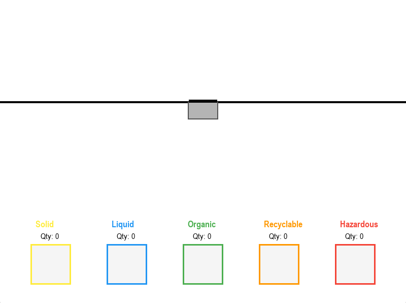

# Smart-Waste-Segregation-and-Transportation-System

## Inspiration💫:
The Inspiration for this is unlike "AIATSS" -my other project- is much less personal. It is a general problem in the world with waste management like sometimes in India, they dump waste in empty grounds, fields ,etc as there are no proper waste disposal system at a local level even if there is it struggles to keep up with the amount of trash that is being generated. I had similar thought of creating a Automatic waste segregation system long time ago but i never built a software like this. Initially for this system i thought of making this system for local use in everyday life but later i realised that is economically less feasable and it is hard to maintain. So for a solution I want this to be used in large scale(near waste segregation plants) as well as in small scale as this technology improves and can be economically suited 

## Built With⚒️:
**Python as the programing language:** Python is used as the main programming language as it runs smoothly, easy to program, errors can be identified fast due to  its simplicity, and it is a powerful tool 

**Pygame for visualisation**: As I don't have suffecient time or resources to do it physically I used pygame(an open source free python library) to visualize or immitate the physical environment and show how this works. Due to its fast 2D object modeling, easily understandeble visual object moddeling and ease of loading through python made it most desirable for this project. 

## **Layout and Object Modeling📐**

**Layout:** Nothing special here just a normal white background with bin at the centre and different waste type slots at the bottom(Solid, Liquid, Hazardous,etc)

**The Bin Mechanism⚙️⚙️:**

*The bin:* The bin has two sliding doors that open upon detecting an entity(for eg, a human or a waste) in its proximity and close when the trash is thrown into the bin in the trash inters into a section where it detects what type of trash it is it.

*The Scanner:* The scanner is a first real part of this which gives it the name "Smart". The scanner detects what type of trash the thrown is and gives the intput to the computer in the bin which sorts the trash according to its type.

*The Trash:* The trash is colour codded according to what type of trash it is

**Solid🟨**-Colour coded as yellow 

**Liquid🟦**-Colour coded as blue

**Organic🟩**-Colour coded as green

**Recyclable🟧**-Colour coded as Orange

**Hazardous🟥**-Colour coded as Red. I put the chances of it appearing in the simulation as 0.0000000000001 as it is very rear for a hazardous item to really come in a public place. 
