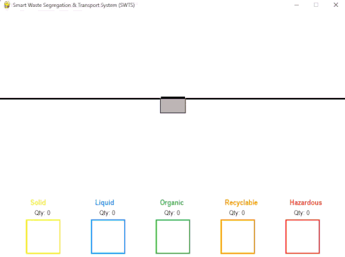

# Smart-Waste-Segregation-and-Transportation-System

## Inspiration💫:
The Inspiration for this is unlike "AIATSS" -my other project- is much less personal. It is a general problem in the world with waste management like sometimes in India, they dump waste in empty grounds, fields ,etc as there are no proper waste disposal system at a local level even if there is it struggles to keep up with the amount of trash that is being generated. I had similar thought of creating a Automatic waste segregation system long time ago but i never built a software like this. Initially for this system i thought of making this system for local use in everyday life but later i realised that is economically less feasable and it is hard to maintain. So for a solution I want this to be used in large scale(near waste segregation plants) as well as in small scale as this technology improves and can be economically suited 

## Built With⚒️:
**Python as the programing language:** Python is used as the main programming language as it runs smoothly, easy to program, errors can be identified fast due to  its simplicity, and it is a powerful tool 

**Pygame for visualisation**: As I don't have suffecient time or resources to do it physically I used pygame(an open source free python library) to visualize or immitate the physical environment and show how this works. Due to its fast 2D object modeling, easily understandeble visual object moddeling and ease of loading through python made it most desirable for this project. 

## **Layout and Object Modeling📐**

### **Layout:** ### 
Nothing special here just a normal white background with bin at the centre and different waste type slots at the bottom(Solid, Liquid, Hazardous,etc)

### **The Bin Mechanism⚙️⚙️:** ###

<ins> **The bin:** </ins>  
The bin has two sliding doors that open upon detecting an entity(for eg, a human or a waste) in its proximity and close when the trash is thrown into the bin in the trash inters into a section where it detects what type of trash it is it.

<ins> **The Scanner:** </ins>  
The scanner is a first real part of this which gives it the name "Smart". The scanner detects what type of trash the thrown is and gives the intput to the computer in the bin which sorts the trash according to its type.

<ins> **The Trash:** </ins>   
The trash is colour codded according to what type of trash it is

**Solid🟨**-Colour coded as yellow 

**Liquid🟦**-Colour coded as blue

**Organic🟩**-Colour coded as green

**Recyclable🟧**-Colour coded as Orange

**Hazardous🟥**-Colour coded as Red. I put the chances of it appearing in the simulation as 0.0000000000001 as it is very rare for a hazardous item to really come in a public place. 

<ins> **The Visitor:** </ins>  
This is an entity that drops the trash into the bin. Initially while I was making this project I took the entity as a person throwing trash into the bin but later I realized in a real world senrario it will take a long time for this kind of a machine to bring in public places like parks, hotels, etc due its it sheer setup costs and maintance costs so I want a vistor to be of two types one for large scale and small scale. 

**Visitor for Large scale:** Usage of this in large scale means in Factories, Material Recovery Facilities (MRFs) or Waste Sorting Plants, or recycle centres where instead of each individual area all the trash comes to one area and get sorted. Although in the final pygame simulation it dosen't look like it is in large scale, even for large scale implementation in is a very identical process to this. Instead of the visitor being a person we can take it as conveyor belt or robots. Of course there would be more trash and multiple of these will work at the same time. Usage of this in large scale will make waste disposal more envieromentally friendly, saves time, and room for further recycling and innovative waste disposal increases.Ultimately, making waste disposal more efficient.   

**Visitor in small scale:** This was my initial idea of this project. Although, later i realised this is economically not feasible I didn't completly rule out this idea. As the usage of this machines increases, as the technology develops, as smart cities grow the usage of this in public or maybe even private spaces increases. Imagine just having a lot of trash at home but you don't have to worry about where you have to throw it as you have this bin in your house and you can just deposit it there and it will sort on its own. The advantages of this are unlike in large scale where you bring everything to one place and then it gets sorted you have to transport all these sorted trash to the respective areas we can just directly take the sorted trash to their respective areas directly (for eg, Recyclable waste can be directly taken to the recycling plant). This also increases effciency and cuts travel costs. 

## Workflow of the System 🧠🚀

### Here is GIF showing how it works:

### <ins>The end-to-end operational flow of the system works as follows:</ins>

**The Entity/Visitor approach and Proximity Detection:**  
As the visitor or automated transport mechanism approaches the bin carrying the trash, entering the bin's entry zone(the minimum distance close enough from the bin that the detectors can determine that the entity is about to throw the trash), the proximity sensors in the bin trigger the dual sliding doors to open automatically.

**Deposit of Waste and Scanning:**  
When the trash enters into the bin the sliding doors close. After entering the trash enters into a small compartment where would be scanners(ideally CV system that were trained rigorously on different waste types); these scanners scan the trash type(in this only kept to 5 for simplicity) and gives the output on which type of trash it is.

**Classification of trash:**  
Based on the scanner's output, the system routes the item to its designated compartment. For example, if the waste type is identified as solid(represented by yellow in SWTS), it gets directly sorted into "Solid" waste type compartment.     

## Future Improvements/ Future of the project 📈

This just a basic representation and a fraction of the capability of this system and there is a lot more work to do. So as a high school student I don't have much time or resouces to further improve the project but that doesn't stop me form thinking of new ideas to take this system to the next level which I can implement in the future or whenever I get time. Here are a few of those:

**Intent-Driven CV and Unpredictability Handling:**   For small scale application of this system, in a crowded real-world environment the visitors won't come in a systematic way. pedestrians frequently pass close to bin's proximity without intending to dispose of waste, the bin may interpret that the person wants to throw the trash in and trigger the sliding doors.So, Relying solely on distance sensors leads to false-positive door triggers, unnecessary power consumption, and potential mechanical wear. To solve this unpredictability, the system can integrate a Computer Vision (CV) mechanism. Instead of reacting blindly to proximity, a low-power camera module running CV can analyze human posture, gaze, and movement in real-time. It evaluates whether a user is actually carrying waste and approaching to discard it, ensuring the sliding doors and sorting mechanics only trigger when genuine intent is detected. 

**Large Scale Implementation:**   Like I mentioned earlier, In current economy this the most fesible option. Although it dosen't look like it in the pygame, the large scale implemention is almost similar to this. We just need to add more capacity to this and more bins working simultaneously. 

**Detection and Separation of Mixed trash** 

